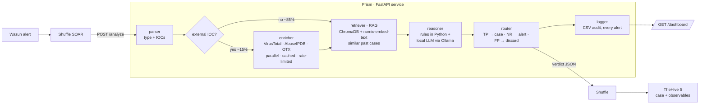
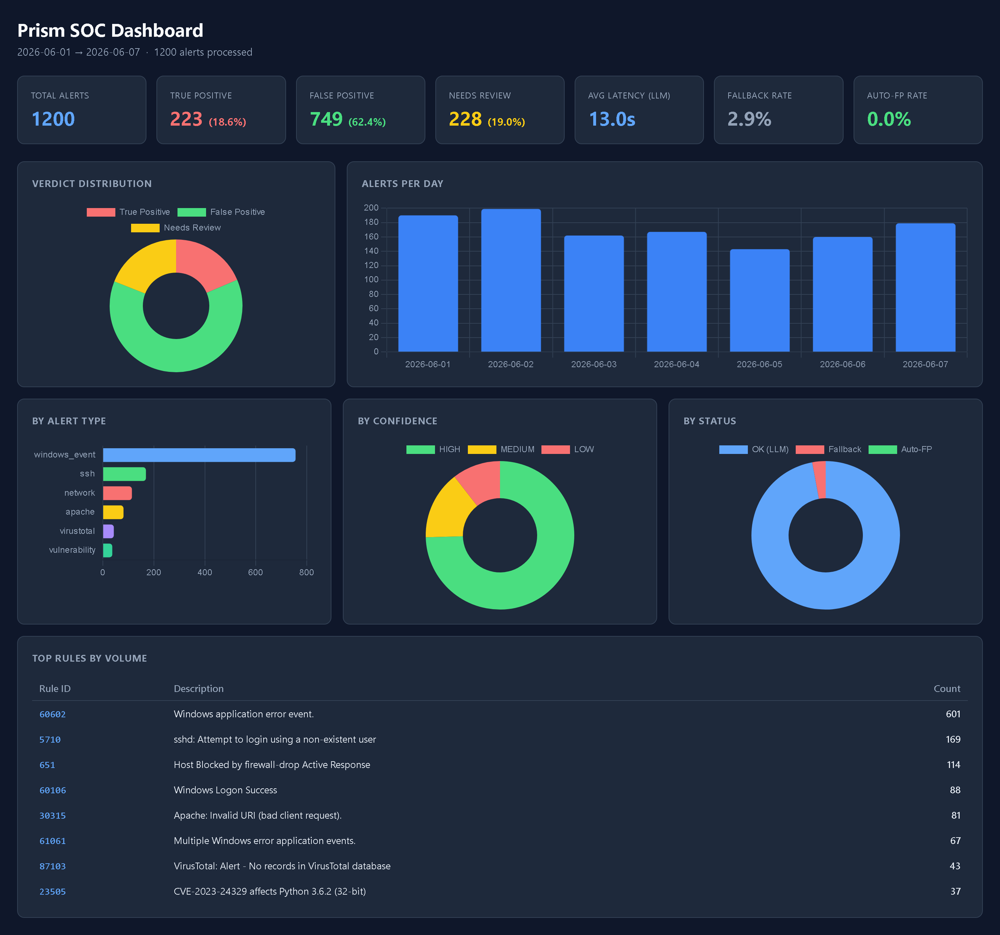

# Prism — On-Premise AI Triage for SOC Alerts

[](https://github.com/mateoullaa/prism/actions/workflows/tests.yml)


[](LICENSE)

> _A prism separates light from noise — exactly what this agent does with security alerts._

Prism automates the **first triage pass of a Security Operations Center**. It receives
[Wazuh](https://wazuh.com/) alerts, enriches their indicators against three threat-intel APIs,
pulls similar past cases from a vector store, and asks a **local LLM** for a verdict. Every rule,
threshold and score that can be decided in code is decided in Python, not by the model. The verdict
goes back to a [Shuffle](https://shuffler.io/) SOAR workflow, which opens cases in
[TheHive 5](https://thehive-project.org/).

| 6,320 | ~7 min → 12–15 s | ~97% | 334 | 100% |
|:---:|:---:|:---:|:---:|:---:|
| real alerts analyzed to design it | first-pass triage per alert, manual vs Prism (both measured) | less triage time | automated tests, no network | on-premise: no alert data leaves the host |

Built and deployed to production during a Cybersecurity Analyst internship at a SOC.

---

## The problem

In a production corpus of **6,320 alerts over 3 days, 61% were one recurring false positive**
(Windows rule 60602, firing every ~30 s on a single endpoint). About 85% of the alerts carried no
external indicator at all. Analysts were re-triaging the same noise by hand, every day.

Prism front-loads that work: it settles the obvious cases, enriches what matters, adds historical
context, and hands the analyst a reasoned verdict instead of a raw alert.

## How it works



| Component | What it does |
|---|---|
| **parser** | Classifies the alert (`ssh`, `network`, `windows_event`, `apache`, `vulnerability`, `virustotal`) and by nature (public attack, internal movement, informational). Extracts IOCs and drops private ranges. Deterministic, no external calls. |
| **enricher** | Queries VirusTotal, AbuseIPDB and OTX AlienVault in parallel, with a token-bucket rate limiter, a TTL cache and a per-source error cache. Skipped when there is no external IOC. |
| **retriever (RAG)** | Embeds the alert signature, fetches the top-K similar past alerts from ChromaDB and summarizes them for the prompt ("Of 5 similar alerts: 4 FP, 1 TP"). An auto-FP path runs in shadow mode. |
| **reasoner** | Builds the prompt from pre-evaluated facts, calls the local model, validates the JSON contract and enforces it. Falls back to a conservative verdict on any failure. |
| **router** | `TRUE_POSITIVE` → TheHive case · `NEEDS_REVIEW` → TheHive alert · `FALSE_POSITIVE` → discard. On any doubt it escalates. |
| **logger** | Writes one CSV audit row per alert, including discarded false positives. No decision goes untraced. |

## Design decisions

**Python decides; the LLM explains.** A 3B model is unreliable at numeric comparisons: during
validation it read an AbuseIPDB confidence of 100 as "low". So Prism evaluates every threshold
in code and hands the model conclusions, not numbers:

- **Enrichment thresholds** (AbuseIPDB score ≥ 80 with ≥ 10 reports, VirusTotal ≥ 5 engines, OTX ≥ 1 pulse) are evaluated in Python. The model sees `HIGH RISK` / `LOW RISK` labels.
- **MITRE ATT&CK** technique is mapped deterministically from the alert type.
- **Risk score** is clamped to the verdict: `FALSE_POSITIVE → 1`, `TRUE_POSITIVE → 8–10`. This removes the drift that BLAS floating-point produces even at `temperature=0`.

**Fail-safe at every layer.** Each tool catches its own errors and returns a conservative result.
The service never answers HTTP 500. An alert that crashes the pipeline is still escalated and logged.

**Shadow mode before automation.** Auto-classifying false positives from RAG precedents is
implemented but only logs what it *would* do, until the corpus is large enough to validate
precision (`scripts/validate_threshold.py`, leave-one-out).

**On-premise by design.** Inference (`qwen2.5:3b`) and embeddings (`nomic-embed-text`) run on
Ollama. Vector search runs in-process. Only IOCs, never full alerts, go to threat-intel APIs.

## Metrics dashboard

`GET /dashboard` is a self-contained dark dashboard (Chart.js) built from the audit log;
`GET /metrics` serves the same numbers as JSON.



<sub>Rendered from a synthetic, seeded audit log (`scripts/render_demo_dashboard.py`). The numbers are illustrative, not production data.</sub>

## Sample response

An Apache exploit attempt from a known-bad IP:

```json
{
  "alert_type": "apache",
  "nature_category": "public_attack",
  "iocs": [{ "value": "185.220.101.1", "type": "ip", "external": true }],
  "enrichment": {
    "185.220.101.1": {
      "virustotal": { "status": "ok", "malicious": 12, "suspicious": 2 },
      "abuseipdb":  { "status": "ok", "abuse_confidence_score": 98, "total_reports": 387 },
      "otx":        { "status": "ok", "pulse_count": 14 }
    }
  },
  "verdict": {
    "verdict": "TRUE_POSITIVE",
    "confidence": "HIGH",
    "risk_score": 9,
    "mitre": { "id": "T1190", "name": "Exploit Public-Facing Application" },
    "justification": "Exploit attempt targeting /admin/.env from a Tor exit node flagged by 12 VT engines, 98% AbuseIPDB confidence, and 14 OTX pulses.",
    "next_action": "Block 185.220.101.1 at the perimeter and audit web server logs for successful access.",
    "key_factors": ["Tor exit node", "High VT score", "OTX: 14 pulses"],
    "tags": ["T1190", "apache", "exploit"],
    "severity_num": 3
  },
  "correlation_summary": "1/1 similar past alerts were TRUE_POSITIVE (avg similarity 94%). High-risk pattern — prioritize review.",
  "routing": { "action": "create_case", "send_to_shuffle": true }
}
```

## Quickstart

```bash
git clone https://github.com/mateoullaa/prism.git && cd prism
cp .env.example .env            # API keys + Ollama host
docker compose up -d            # Ollama runs on the host, reached via host-gateway
curl -X POST localhost:8000/analyze \
     -H "Content-Type: application/json" \
     -d @data/sample_alerts/apache_attack.json
```

Local development and tests:

```bash
python -m venv .venv && source .venv/bin/activate   # .venv/Scripts/activate on Windows
pip install -r requirements.txt
pytest -q                  # 334 tests, ~10 s, fully mocked — no network, no Ollama
pytest -m live             # optional: 7 live checks against a real Ollama + threat-intel APIs
```

## Tests

| Component | Tests |
|---|---:|
| parser | 63 |
| enricher | 31 |
| reasoner | 94 |
| retriever (RAG) | 34 |
| router | 29 |
| logger | 23 |
| service + pipeline | 46 |
| metrics | 14 |
| **Total** | **334** |

External clients (Ollama, VirusTotal, AbuseIPDB, OTX, ChromaDB) are injected, so every component is
tested with mocks. CI runs the suite on Python 3.10 and 3.12.

## Tech stack

Python · FastAPI · Ollama (`qwen2.5:3b`, `nomic-embed-text`) · ChromaDB · VirusTotal / AbuseIPDB /
OTX APIs · Wazuh · Shuffle · TheHive 5 · Docker Compose · pytest · GitHub Actions

## How it was built

Prism was built with a structured AI-assisted workflow in [Claude Code](https://claude.com/claude-code):
an orchestrator delegates each component to **builder**, **reviewer** and **scribe** subagents
(`.claude/`). I set scope, made the design calls and validated every version against live
production alerts. The workflow leaves an audit trail:

- [`docs/development/memory.md`](docs/development/memory.md) — the decisions and bugs found along the way (e.g. the LLM misreading threat scores, which led to the "Python decides" rule).
- [`docs/development/PROGRESS.md`](docs/development/PROGRESS.md) — build log, component by component.
- [`docs/development/workflows/`](docs/development/workflows/) — one SOP per component.
- [`docs/ARCHITECTURE.md`](docs/ARCHITECTURE.md) — design and trade-offs.

<details>
<summary>Version history</summary>

| Version | Scope |
|---|---|
| v1 | Core pipeline: parse → enrich → reason → route → log, returned to Shuffle |
| v2 | OTX enrichment, observables, tags, case description, TheHive integration |
| v2.1 | Apache alert type, deterministic MITRE mapping, risk-score enforcement, Docker |
| v2.2 | RAG context injection, shadow auto-FP, correlation summary, metrics dashboard |

</details>

<details>
<summary>Environment variables</summary>

| Variable | Description |
|---|---|
| `VIRUSTOTAL_API_KEY` | VirusTotal API key |
| `ABUSEIPDB_API_KEY` | AbuseIPDB API key |
| `OTX_API_KEY` | OTX AlienVault API key |
| `OLLAMA_HOST` / `OLLAMA_MODEL` | Ollama base URL and model (default `qwen2.5:3b`) |
| `RAG_ENABLED` / `RAG_SHADOW_MODE` | Enable the retriever / log auto-FP decisions without acting |
| `AUTO_FP_THRESHOLD` | Cosine similarity for an auto-FP precedent (default `0.92`) |

The full list with defaults is in [`.env.example`](.env.example).

</details>

## License

[MIT](LICENSE) © 2026 Mateo Ulla. Sample alerts in `data/sample_alerts/` are anonymized: hostnames
and internal addresses are placeholders, and the external IPs are public attacker indicators.
